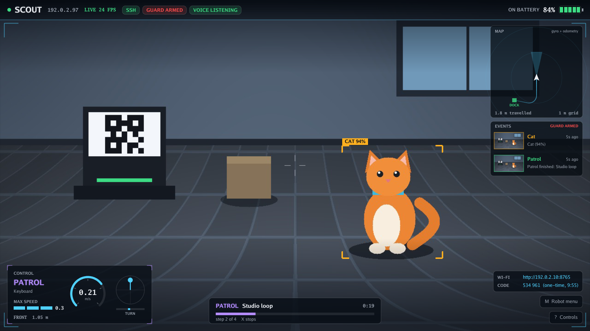
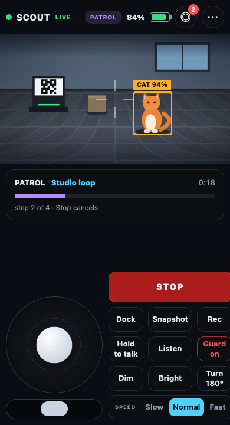

# Scout

A Go desktop and headless controller for **Moorebot Scout** with keyboard/Xbox
controls, live HUD, patrol routes, guard mode, a responsive web/phone UI, an
on-device Apple Intelligence voice assistant, and an authenticated local API +
MCP server.

| Desktop HUD | Mobile Web UI |
|---|---|
|  |  |

*Synthetic test-studio captures with documentation addresses (`192.0.2.x`). See also [Phone & tablet pairing QR](docs/screenshots/menu-phone.png).*

## Requirements

- **Go 1.25+**
- **Python 3** (for `scripts/build.py` and `scripts/package.py`)
- **`ffmpeg`** on `PATH` (optional for JPEG/MJPEG/AAC; required for H.264 stream,
  MP4 recording and WAV audio)
- **SSH keys** for `root@<host>` (optional; enables speaker playback, live
  battery/health reads, Wi-Fi management, robot clips and verified docking)
- **macOS 26+ on Apple silicon** with Apple Intelligence enabled (optional, for
  `scout-voice`)

## Build & Run

```sh
python3 scripts/build.py          # builds dist/scout, dist/scoutctl (+ scout-voice on Apple Silicon)
./dist/scout                      # enter the robot IP in the window (saved for next time)
./dist/scout -host 192.168.1.97   # or pass it once; run ./dist/scout -h for all flags
```

Or use `make build`, `go build -trimpath -o dist/scout .`, or on Windows PowerShell:

```powershell
py scripts\build.py
.\dist\scout.exe -host 192.168.1.97
```

To build a release bundle (`dist/Scout.app` on macOS and `dist/scout-<os>-<arch>.zip`):

```sh
python3 scripts/package.py                         # host OS/arch (or make package)
python3 scripts/package.py --os windows --arch amd64
```

Pass `--no-voice` to `build.py` or `package.py` on Apple Silicon macOS if
building without the macOS 26 SDK.

## Features

- **Desktop HUD & map:** Live camera feed, battery/SSH/recording status,
  dead-reckoned map with forward obstacle distance, motion/person/pet boxes,
  and an event timeline. Press `M` for the Robot menu (patrols, guard mode,
  camera settings, robot clips, health, obstacle guard, Wi-Fi, Phone & tablet,
  reset, factory restore).
- **Measured moves & obstacle guard:** Closed-loop wheel-odometry moves
  (`/v1/move`), gyro turns (`/v1/turn`), and forward ToF obstacle slowdown/stop
  (always on for moves, patrols and agents; toggleable for manual driving).
- **Assisted & verified docking:** Moves into view in front of the dock when
  mapped, runs firmware QR docking, and verifies charging over SSH (optional
  low-battery auto-dock).
- **Guard mode & patrols:** Motion and on-robot people/pet alerts with
  snapshots (and optional macOS notifications), plus recorded/scheduled patrol
  routes that return to dock.
- **Voice assistant (`-voice` or `V`):** `scout-voice` runs on-device speech
  recognition and Apple foundation model tool calling on Apple silicon macOS
  26+, speaking replies via the robot speaker. Supports `--source mac` and
  `--text "…" --dry-run`.
- **Phone & browser UI (`127.0.0.1:8765`):** Responsive HUD with touch joystick
  and talk/listen controls. Pair from `M` → **Phone & tablet** using Tailscale
  (`tailscale serve`, QR scan) or LAN HTTP (`L` or `-lan`) and the 6-digit
  one-time code.
- **CLI, HTTP API & MCP:** Drive and automate Scout with `scoutctl` or expose
  tools to assistants via `scoutctl mcp` — see [AGENT_API.md](AGENT_API.md).

## Controls

| Action | Keyboard | Xbox controller |
|---|---|---|
| Forward/back and turn | `W`/`S`/`A`/`D` or arrows | Left stick |
| Strafe | `Q`/`E` | Right stick horizontal |
| Stop all / cancel docking | `X` | `B` or `LB` + `RB` |
| Speed `-` / `+` (0.1–0.3 m/s) | `O` / `P` | `LB` / `RB` |
| Dock | `H` | `Y` |
| Screenshot (`~/Pictures/Scout` in `Scout.app`) | `Space` | `A` |
| Night vision brightness `-` / `+` | `9` / `0` | D-pad down / up |
| Auto light | Agent API | `X` |
| Record MP4 (`~/Movies/Scout` in `Scout.app`) | `R` | — |
| Guard mode on/off | `G` | — |
| Voice assistant on/off | `V` | — |
| Clean HUD / fullscreen / controls | `Tab` / `F` / `?` | — |
| Robot menu / exit | `M` / `Esc` | — / `Menu` |

Run `-input-test` to verify keyboard and gamepad mappings offline (Xbox
controllers pair over Bluetooth on macOS; use `-c keyboard` or `-c gamepad` to
force a mode).

## Platform & Connection Notes

- **Addressing & SSH:** By default `-host <ip>` sets ROS master `<ip>:11311` and
  SSH `root@<ip>` using your existing SSH keys/agent (override with `-r`, `-ssh`,
  `-no-ssh`; press `Tab` on the connect screen to scan the LAN). First connect
  adds the host key to `known_hosts` and refuses changed keys.
- **macOS permissions:** Allow **Local Network** access and incoming ROS
  connections in the macOS firewall. `Scout.app` is ad-hoc signed, not notarized.
- **Windows firewall:** Allow incoming ROS callbacks on your trusted private
  network (`-ssh` uses Windows OpenSSH Client).
- **Headless / API-only:** Run `-headless` (requires `-api`, default
  `127.0.0.1:8765`; pass `-api off` to disable both API and web UI).

## Tests

```sh
make vet
make test
```

Offline tests use synthetic inputs and loopback mocks (see
[AGENT_API.md](AGENT_API.md)).

## Local Data

Settings, saved host/routes/events, and the `0600` `api-token` live in your OS
config directory (`~/Library/Application Support/Scout/` on macOS). Override the
token with `SCOUT_API_TOKEN`. Captures, logs, keys, local binaries and `.env`
files are gitignored.

## Provenance

Based on [Shell-Company/go-scout](https://github.com/Shell-Company/go-scout).
The vendored [goroslib](third_party/goroslib) copy includes transport and
cancellation fixes under its [MIT license](third_party/goroslib/LICENSE).
